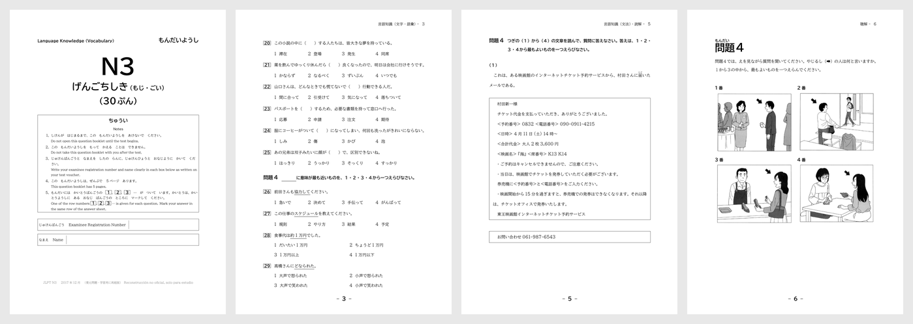
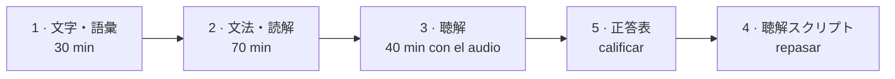
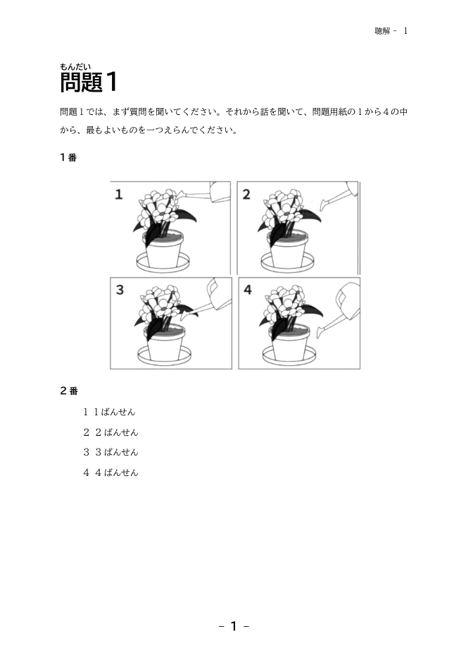
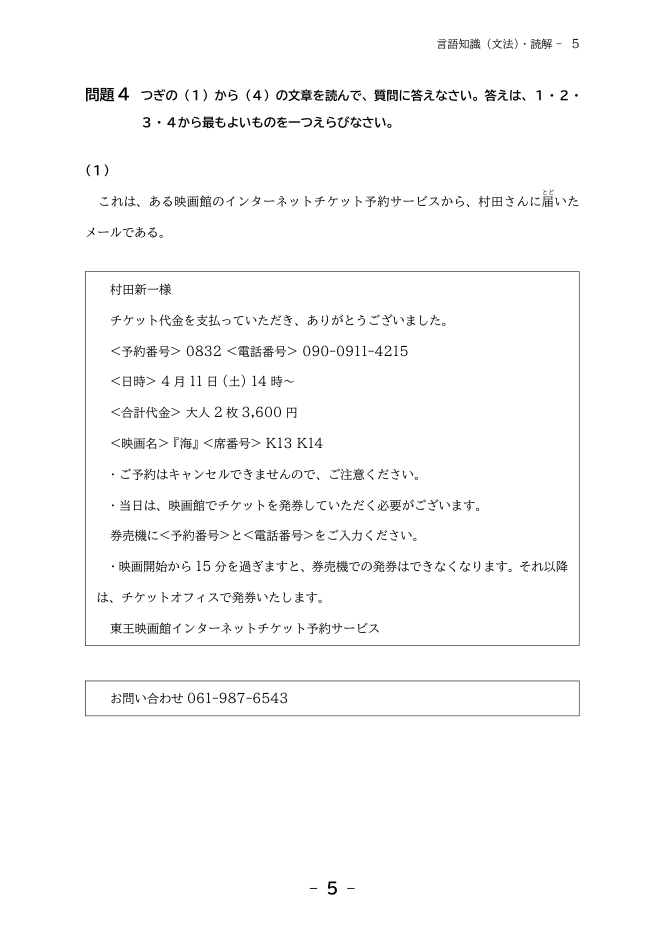
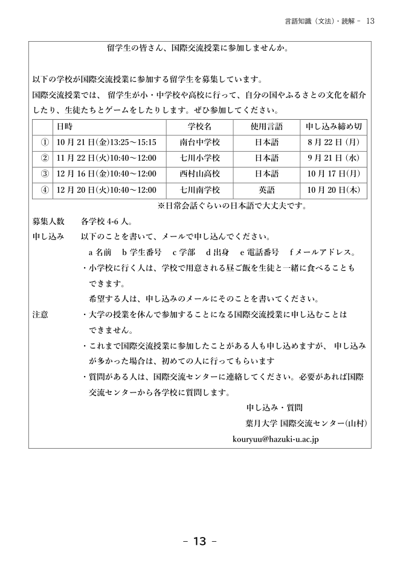

# JLPT N3 — Simulacros remasterizados (2010–2024)

Veintinueve exámenes pasados del JLPT N3, reconstruidos y maquetados de nuevo con el formato del
cuadernillo oficial para hacer simulacros en condiciones reales: tres cuadernillos sin contestar,
el audio del listening, el guion y la clave de respuestas de cada examen.



> **Material no oficial y de uso personal.** Son reconstrucciones de terceros de los exámenes
> (Dungmori, JLPT Mogi/Yuuki Bùi, 沪江, 日语轻松考), no cuadernillos publicados por la JLPT. Los
> derechos de las preguntas corresponden a la Fundación Japón y a JEES, y los de los dibujos y
> audios, a sus autores. Por eso este repositorio es privado: no lo hagas público ni redistribuyas
> su contenido.

## Contenido de cada examen

Cada carpeta de [`examenes/`](examenes/) contiene:

| Archivo | Qué es | Cuándo usarlo |
|---|---|---|
| `1 - 言語知識（文字・語彙）.pdf` | Cuadernillo de vocabulario | Simulacro, 30 min |
| `2 - 言語知識（文法）・読解.pdf` | Cuadernillo de gramática y lectura | Simulacro, 70 min |
| `3 - 聴解.pdf` | Cuadernillo de listening | Simulacro, 40 min con el audio |
| `4 - 聴解スクリプト.pdf` | Guion completo del listening | Después, para repasar |
| `5 - 正答表.pdf` | Clave de respuestas | Después, para calificar |

El audio de cada examen está en la *release* [`audio`](https://github.com/Eliam4510/jlpt-n3-simulacros/releases/tag/audio)
(fuera del historial de git para que clonar el repositorio sea rápido) y se enlaza en la tabla de
exámenes. La hoja de respuestas no se incluye: usa la oficial (解答用紙).

## Cómo hacer un simulacro



1. Imprime los cuadernillos 1, 2 y 3 y una hoja de respuestas oficial.
2. Haz cada sección con su tiempo. El audio del listening se pone de corrido, sin pausas, como en el
   examen.
3. Califica con `5 - 正答表.pdf` y repasa el listening con `4 - 聴解スクリプト.pdf` y el audio.

Para aprobar el N3 hacen falta 95 de 180 puntos en total y al menos 19 de 60 en cada parte
(言語知識, 読解 y 聴解). La JLPT puntúa con una escala ajustada, no por número de aciertos, así que el
recuento de aciertos solo da una idea aproximada.

## Exámenes

| Examen | Convocatoria | Preguntas | Audio | Observaciones |
|---|---|---|---|---|
| [2010-07](examenes/2010-07/) | julio de 2010 | 102 | [MP3](https://github.com/Eliam4510/jlpt-n3-simulacros/releases/download/audio/N3-2010-07-chokai.mp3) |  |
| [2010-12](examenes/2010-12/) | diciembre de 2010 | 28 | [M4A](https://github.com/Eliam4510/jlpt-n3-simulacros/releases/download/audio/N3-2010-12-chokai.m4a) | Solo listening; en 問題1 y 2 faltan las opciones impresas |
| [2011-07](examenes/2011-07/) | julio de 2011 | 101 | [MP3](https://github.com/Eliam4510/jlpt-n3-simulacros/releases/download/audio/N3-2011-07-chokai.mp3) | 問題5 de listening con 8 ítems |
| [2011-12](examenes/2011-12/) | diciembre de 2011 | 101 | [MP3](https://github.com/Eliam4510/jlpt-n3-simulacros/releases/download/audio/N3-2011-12-chokai.mp3) | 問題5 de listening con 8 ítems |
| [2012-07](examenes/2012-07/) | julio de 2012 | 102 | [MP3](https://github.com/Eliam4510/jlpt-n3-simulacros/releases/download/audio/N3-2012-07-chokai.mp3) |  |
| [2012-12](examenes/2012-12/) | diciembre de 2012 | 102 | [MP3](https://github.com/Eliam4510/jlpt-n3-simulacros/releases/download/audio/N3-2012-12-chokai.mp3) |  |
| [2013-07](examenes/2013-07/) | julio de 2013 | 102 | [MP3](https://github.com/Eliam4510/jlpt-n3-simulacros/releases/download/audio/N3-2013-07-chokai.mp3) |  |
| [2013-12](examenes/2013-12/) | diciembre de 2013 | 102 | [MP3](https://github.com/Eliam4510/jlpt-n3-simulacros/releases/download/audio/N3-2013-12-chokai.mp3) | Listening 問題5 6番 sin opciones (error de la fuente) |
| [2014-07](examenes/2014-07/) | julio de 2014 | 102 | [MP3](https://github.com/Eliam4510/jlpt-n3-simulacros/releases/download/audio/N3-2014-07-chokai.mp3) |  |
| [2014-12](examenes/2014-12/) | diciembre de 2014 | 102 | [MP3](https://github.com/Eliam4510/jlpt-n3-simulacros/releases/download/audio/N3-2014-12-chokai.mp3) |  |
| [2015-07](examenes/2015-07/) | julio de 2015 | 102 | [MP3](https://github.com/Eliam4510/jlpt-n3-simulacros/releases/download/audio/N3-2015-07-chokai.mp3) |  |
| [2015-12](examenes/2015-12/) | diciembre de 2015 | 102 | [MP3](https://github.com/Eliam4510/jlpt-n3-simulacros/releases/download/audio/N3-2015-12-chokai.mp3) |  |
| [2016-07](examenes/2016-07/) | julio de 2016 | 102 | [MP3](https://github.com/Eliam4510/jlpt-n3-simulacros/releases/download/audio/N3-2016-07-chokai.mp3) |  |
| [2016-12](examenes/2016-12/) | diciembre de 2016 | 102 | [MP3](https://github.com/Eliam4510/jlpt-n3-simulacros/releases/download/audio/N3-2016-12-chokai.mp3) |  |
| [2017-07](examenes/2017-07/) | julio de 2017 | 102 | [MP3](https://github.com/Eliam4510/jlpt-n3-simulacros/releases/download/audio/N3-2017-07-chokai.mp3) |  |
| [2017-12](examenes/2017-12/) | diciembre de 2017 | 102 | [MP3](https://github.com/Eliam4510/jlpt-n3-simulacros/releases/download/audio/N3-2017-12-chokai.mp3) |  |
| [2018-07](examenes/2018-07/) | julio de 2018 | 102 | [MP3](https://github.com/Eliam4510/jlpt-n3-simulacros/releases/download/audio/N3-2018-07-chokai.mp3) |  |
| [2018-12](examenes/2018-12/) | diciembre de 2018 | 102 | [MP3](https://github.com/Eliam4510/jlpt-n3-simulacros/releases/download/audio/N3-2018-12-chokai.mp3) |  |
| [2019-07](examenes/2019-07/) | julio de 2019 | 102 | [MP3](https://github.com/Eliam4510/jlpt-n3-simulacros/releases/download/audio/N3-2019-07-chokai.mp3) |  |
| [2019-12](examenes/2019-12/) | diciembre de 2019 | 102 | [MP3](https://github.com/Eliam4510/jlpt-n3-simulacros/releases/download/audio/N3-2019-12-chokai.mp3) |  |
| [2020-12](examenes/2020-12/) | diciembre de 2020 | 101 | [MP3](https://github.com/Eliam4510/jlpt-n3-simulacros/releases/download/audio/N3-2020-12-chokai.mp3) |  |
| [2021-07](examenes/2021-07/) | julio de 2021 | 101 | [MP3](https://github.com/Eliam4510/jlpt-n3-simulacros/releases/download/audio/N3-2021-07-chokai.mp3) |  |
| [2021-12](examenes/2021-12/) | diciembre de 2021 | 101 | [MP3](https://github.com/Eliam4510/jlpt-n3-simulacros/releases/download/audio/N3-2021-12-chokai.mp3) |  |
| [2022-07](examenes/2022-07/) | julio de 2022 | 99 | [MP3](https://github.com/Eliam4510/jlpt-n3-simulacros/releases/download/audio/N3-2022-07-chokai.mp3) | 34 preguntas de vocabulario y una de 問題7 |
| [2022-12](examenes/2022-12/) | diciembre de 2022 | 101 | [MP3](https://github.com/Eliam4510/jlpt-n3-simulacros/releases/download/audio/N3-2022-12-chokai.mp3) |  |
| [2023-07](examenes/2023-07/) | julio de 2023 | 101 | [MP3](https://github.com/Eliam4510/jlpt-n3-simulacros/releases/download/audio/N3-2023-07-chokai.mp3) |  |
| [2023-12](examenes/2023-12/) | diciembre de 2023 | 101 | [MP3](https://github.com/Eliam4510/jlpt-n3-simulacros/releases/download/audio/N3-2023-12-chokai.mp3) |  |
| [2024-07](examenes/2024-07/) | julio de 2024 | 101 | [MP3](https://github.com/Eliam4510/jlpt-n3-simulacros/releases/download/audio/N3-2024-07-chokai.mp3) | 読解 24: la opción 4 viene de otra pregunta |
| [2024-12](examenes/2024-12/) | diciembre de 2024 | 101 | — | Sin audio todavía |

## Estructura del examen

Estructura oficial del N3 según la guía de la JLPT, que siguen los cuadernillos.

| Sección | 問題 | Tipo | Preguntas |
|---|---|---|---|
| 言語知識（文字・語彙）· 30 min | 1 | 漢字読み | 8 |
| | 2 | 表記 | 6 |
| | 3 | 文脈規定 | 11 |
| | 4 | 言い換え類義 | 5 |
| | 5 | 用法 | 5 |
| 言語知識（文法）・読解 · 70 min | 1 | 文法形式の判断 | 13 |
| | 2 | 文の組み立て | 5 |
| | 3 | 文章の文法 | 5 (4 desde dic. 2020) |
| | 4 | 内容理解（短文） | 4 |
| | 5 | 内容理解（中文） | 6 |
| | 6 | 内容理解（長文） | 4 |
| | 7 | 情報検索 | 2 |
| 聴解 · 40 min | 1 | 課題理解 | 6 |
| | 2 | ポイント理解 | 6 |
| | 3 | 概要理解 | 3 |
| | 4 | 発話表現 | 4 |
| | 5 | 即時応答 | 9 |

## Formato

- Maquetado con LuaLaTeX en A4, con las piezas del cuadernillo oficial: portada con ちゅうい,
  número de pregunta en recuadro, subrayados, huecos con ★, cabecera de sección y pie de página.
- Tipografía Morisawa, la misma casa que la del examen real: BIZ UD明朝 para el texto y
  BIZ UDゴシック para los títulos, a 12 pt.
- Los textos de lectura reproducen su fuente: recuadro donde la fuente lo tiene (mails, avisos, el
  texto de 文法 問題3), títulos centrados, firmas a la derecha y el furigana que la fuente trae en
  文法 y 読解 (nunca en 文字・語彙).
- Dibujos y folletos son la página original recortada, en blanco y negro y sin marcas de agua:
  - las láminas de 問題1 alcanzan 9 cm de alto;
  - en 問題4 cada dibujo va aparte, en una rejilla de 2 × 2;
  - los folletos de 問題7 se imprimen a su tamaño original.

<table>
<tr>
<td></td>
<td></td>
<td></td>
</tr>
</table>

## Calidad

- **Texto:** todo 文字・語彙, 文法 y 読解 se cotejó pregunta por pregunta con una segunda edición
  escaneada de cada examen. Se corrigieron 506 erratas.
- **Claves:**
  - las de 漢字読み y 表記 (391 preguntas) se verificaron con un analizador morfológico;
  - donde dos fuentes no coincidían, se decidió leyendo la pregunta.
- **Guiones de listening:** coinciden en un 85–95 % con las transcripciones independientes que
  existen.
- **Maquetación:** los 143 PDF están comprobados (ningún carácter sin glifo, ninguna línea fuera del
  margen, ningún dibujo ni renglón partido por un recorte) y revisados página a página.

Lo que falta en las fuentes, las correcciones hechas a mano y las dudas abiertas están en la
[fe de erratas](FE_DE_ERRATAS.md).

## Banco de preguntas (CSV)

[`banco-csv/`](banco-csv/) reúne las 2871 preguntas de los 29 exámenes en tablas UTF-8, que se abren
en Excel, Google Sheets o Anki:

| Archivo | Contenido |
|---|---|
| `1_vocabulario_todos.csv` | 979 preguntas de 文字・語彙 |
| `2_gramatica_todos.csv` | 635 preguntas de 文法 |
| `3_lectura_todos.csv` | 447 preguntas de 読解, con el texto completo en `pasaje` |
| `4_listening_todos.csv` | 810 preguntas de 聴解, con el guion completo en `guion` |
| `resumen_por_examen.csv` | Preguntas por examen y cuántas llevan aviso |

Columnas principales: `id` (`2015-07_V1_03` = examen, sección, 問題 y número), `tipo` (nombre oficial
del 問題), `enunciado` (【…】 = subrayado, ＿＿ = hueco, ★ = hueco con estrella), `opcion_1`…`opcion_4`,
`respuesta`, `respuesta_texto` y `revisar` (erratas corregidas y avisos de cada pregunta). Las
columnas `imagen` y `audio` indican el cuadernillo y el archivo de audio correspondientes.

## Estructura del repositorio

```
jlpt-n3-simulacros/
├── README.md
├── FE_DE_ERRATAS.md
├── examenes/
│   ├── 2010-07/
│   │   ├── 1 - 言語知識（文字・語彙）.pdf
│   │   ├── 2 - 言語知識（文法）・読解.pdf
│   │   ├── 3 - 聴解.pdf
│   │   ├── 4 - 聴解スクリプト.pdf
│   │   └── 5 - 正答表.pdf
│   └── …                    (29 exámenes, de 2010-07 a 2024-12)
├── banco-csv/
└── docs/muestras/
```
